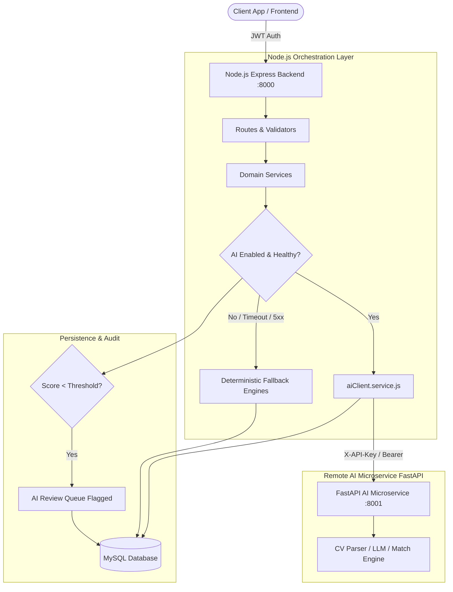

# 🤖 SkillMatch — AI Endpoints & Integration Guide

Comprehensive documentation of the **SkillMatch AI Integration Layer**, detailing the architecture, endpoints, dual-pipeline orchestration (Remote AI Microservice with seamless Deterministic Fallback Engines), authentication protocols, and human-in-the-loop moderation.

---

## 📑 Table of Contents

- [Part 1: Architectural Overview & Dual-Pipeline Design](#part-1-architectural-overview--dual-pipeline-design)
- [Part 2: Authentication, Security Handshake & Environment Setup](#part-2-authentication-security-handshake--environment-setup)
- [Part 3: CV Parsing & Profile Extraction Pipeline](#part-3-cv-parsing--profile-extraction-pipeline)
- [Part 4: Job Understanding, Explainable Matching & Skill Gaps](#part-4-job-understanding-explainable-matching--skill-gaps)
- [Part 5: Dynamic Career Roadmap Generator](#part-5-dynamic-career-roadmap-generator)
- [Part 6: AI Interview Coach & Answer Evaluation](#part-6-ai-interview-coach--answer-evaluation)
- [Part 7: AI Career Mentor & Contextual Streaming Chat](#part-7-ai-career-mentor--contextual-streaming-chat)
- [Part 8: Application Strategy & Readiness Assessment](#part-8-application-strategy--readiness-assessment)
- [Part 9: CV Improvement & Tailoring Assistant](#part-9-cv-improvement--tailoring-assistant)
- [Part 10: Human-in-the-Loop AI Review Queue (Admin Moderation)](#part-10-human-in-the-loop-ai-review-queue-admin-moderation)
- [Part 11: Resilience, Circuit-Breaker Pattern & Fallback Engines](#part-11-resilience-circuit-breaker-pattern--fallback-engines)
- [Part 12: Testing, cURL Workflows & Troubleshooting](#part-12-testing-curl-workflows--troubleshooting)

---

## Part 1: Architectural Overview & Dual-Pipeline Design

SkillMatch incorporates a **Dual-Engine Architecture** ensuring zero-downtime high availability:



### Core Architectural Principles
1. **Separation of Concerns**: The Node.js server handles authentication, candidate session persistence, database operations, business invariants, and client response formatting. The Python FastAPI microservice runs LLM inferences, text embeddings, and semantic parsing.
2. **Circuit-Breaker & Deterministic Fallbacks**: Every AI-powered domain contains a synchronous, deterministic rule-based fallback engine. If the remote AI service is disabled or encounters network latency/errors, the backend smoothly falls back without returning an error to the user.
3. **Audit Logging & Verification**: All AI generations below `AI_CONFIDENCE_THRESHOLD` are flagged into the `AiReviewItem` table for human-in-the-loop administrative moderation.

---

## Part 2: Authentication, Security Handshake & Environment Setup

### 2.1 Two-Tier Security Model
- **Client to Node.js Gateway**: Authenticated using standard JSON Web Tokens (`Authorization: Bearer <JWT>`). Role-Based Access Control (`ensureActiveCandidate` or `ensureActiveAdmin`) guards each endpoint.
- **Node.js Gateway to AI Microservice**: Handled securely via `X-API-Key` or `Authorization: Bearer <AI_SERVICE_SECRET_KEY>`. The client never has access to the AI microservice credentials directly.

### 2.2 Environment Configuration Flags (`.env`)

```dotenv
# --- AI Remote Microservice Configuration ---
AI_PROVIDER=remote
AI_CONFIDENCE_THRESHOLD=0.70
AI_SERVICE_BASE_URL=https://ai-serv5.fastapicloud.dev
AI_SERVICE_SECRET_KEY=your_secure_ai_api_key_here
AI_SERVICE_API_KEY=your_secure_ai_api_key_here

# --- Granular Domain Toggles (true = remote AI, false = local rule engine) ---
AI_MATCH_SERVICE_ENABLED=true
AI_STRATEGY_SERVICE_ENABLED=true
AI_CV_IMPROVER_SERVICE_ENABLED=true
AI_INTERVIEW_COACH_ENABLED=true
AI_MENTOR_SERVICE_ENABLED=true
AI_ROADMAP_SERVICE_ENABLED=true
```

---

## Part 3: CV Parsing & Profile Extraction Pipeline

Extracts candidate contact information, headline, work experiences, education history, and identified skills directly from `.pdf`, `.docx`, or raw text.

### 3.1 Node.js Candidate Endpoints

#### Upload CV Document
- **Endpoint:** `POST /api/cv/upload`
- **Auth:** Candidate Bearer Token
- **Content-Type:** `multipart/form-data`
- **Form Data:**
  - `cv`: Binary document (`.pdf`, `.docx`, max 5MB).
- **Behavior:** Stores file in `/storage/cv_documents/`, dispatches extraction job, and triggers AI parsing.

#### Check Extraction Status
- **Endpoint:** `GET /api/cv/status/:cvDocument`
- **Response (200 OK):**
```json
{
  "status": "success",
  "data": {
    "id": 42,
    "file_name": "resume.pdf",
    "parsing_status": "completed",
    "parsed_data": {
      "headline": "Senior Full-Stack Engineer",
      "extracted_skills": ["Node.js", "Express", "Sequelize", "Docker"],
      "confidence_score": 0.94
    }
  }
}
```

#### Verify / Accept Extraction
- **Endpoint:** `POST /api/cv/extractions/:extraction/verify`
- **Body:**
```json
{
  "verified_skills": [
    { "skill_name": "Node.js", "proficiency": "expert", "years_of_experience": 5 },
    { "skill_name": "MySQL", "proficiency": "intermediate", "years_of_experience": 3 }
  ],
  "update_profile": true
}
```

### 3.2 Underlying Remote AI Microservice Endpoints
- `POST /api/v1/cv/extract-file` — Direct binary multipart parsing.
- `POST /api/v1/cv/extract-text` — Raw string parser for extracted CV text.

---

## Part 4: Job Understanding, Explainable Matching & Skill Gaps

Calculates bidirectional suitability scores between candidate profiles and job postings, providing an explainable mathematical breakdown of match factors.

### 4.1 Scoring Formula

$$\text{Final Score} = (\text{Skills Match} \times 0.50) + (\text{Experience Match} \times 0.25) + (\text{Title/Role Match} \times 0.15) + (\text{Work Mode/Location} \times 0.10)$$

### 4.2 Node.js Candidate Endpoints

#### Get Explainable Match Report
- **Endpoint:** `GET /api/jobs/:jobPost/match`
- **Auth:** Candidate Bearer Token
- **Response (200 OK):**
```json
{
  "data": {
    "job_id": 105,
    "candidate_id": 12,
    "overall_score": 88,
    "fit_category": "Strong Match",
    "breakdown": {
      "skill_score": 90,
      "experience_score": 85,
      "title_score": 90,
      "location_score": 80
    },
    "matched_skills": [
      { "name": "Node.js", "proficiency": "advanced", "required": true },
      { "name": "MySQL", "proficiency": "intermediate", "required": true }
    ],
    "missing_skills": [
      { "name": "Redis", "importance": "preferred" }
    ],
    "explanation": "Candidate matches 4 of 5 core competencies with substantial industry experience."
  }
}
```

#### Recalculate Match
- **Endpoint:** `POST /api/jobs/:jobPost/match/recalculate`
- **Response (200 OK):** Forces cache invalidation and recalculates match metrics.

#### Personalized Job Recommendations
- **Endpoint:** `GET /api/candidate/recommended-jobs?page=1&limit=10`
- Returns paginated jobs ordered by AI match score with personalized match badges.

#### Candidate Aggregate Skill Gaps
- **Endpoint:** `GET /api/candidate/skill-gaps`
- Aggregates missing critical skills across all candidate's saved and applied vacancies.

---

## Part 5: Dynamic Career Roadmap Generator

Generates adaptive, multi-phase learning curricula customized to target roles and identified skill gaps.

### 5.1 Node.js Endpoints

#### Generate Dynamic Roadmap
- **Endpoint:** `POST /api/roadmaps`
- **Auth:** Candidate Bearer Token
- **Rate Limit:** 5 requests/minute (`roadmapLimiter`)
- **Body:**
```json
{
  "target_role": "Senior Backend Architect",
  "role_family": "Engineering",
  "skill_gaps": ["Docker", "Kubernetes", "Microservices"]
}
```
- **Response (201 Created):**
```json
{
  "status": "success",
  "message": "Roadmap created successfully.",
  "data": {
    "id": 18,
    "target_role": "Senior Backend Architect",
    "completion_percentage": 0,
    "milestones": [
      {
        "id": 101,
        "title": "Phase 1: Cloud & Container Fundamentals",
        "order": 1,
        "tasks": [
          {
            "id": 201,
            "title": "Master Docker Containerization",
            "description": "Build multi-stage Dockerfiles and container networks.",
            "estimated_hours": 15,
            "status": "pending"
          }
        ]
      }
    ]
  }
}
```

#### Refresh Roadmap Against Emerging Gaps
- **Endpoint:** `POST /api/roadmaps/:roadmap/refresh`
- Adjusts ongoing milestone task lists when a candidate targets new jobs.

#### Complete Milestone Task
- **Endpoint:** `PATCH /api/roadmaps/tasks/:roadmapTask/complete`
- **Body:**
```json
{
  "status": "completed",
  "notes": "Finished Docker deep dive hands-on lab."
}
```
- Recalculates milestone and overall roadmap progress percentage.

---

## Part 6: AI Interview Coach & Answer Evaluation

Interactive mock interview sessions generating role-targeted multiple choice and essay questions with automated grading.

### 6.1 Node.js Endpoints

#### Start Mock Interview Session
- **Endpoint:** `POST /api/interview-prep/sessions`
- **Body:**
```json
{
  "target_role": "DevOps Engineer",
  "difficulty": "medium",
  "job_post_id": 105
}
```
- **Response (201 Created):** Generates 5–10 structured technical, behavioral, and situational questions.

#### Submit & Evaluate Single Answer
- **Endpoint:** `POST /api/interview-prep/sessions/:session/evaluate`
- **Body:**
```json
{
  "question_id": "q_401",
  "user_answer": "In microservices, idempotency prevents duplicate operations when network retries occur, typically implemented using unique transaction keys."
}
```
- **Response (200 OK):**
```json
{
  "status": "success",
  "message": "Answer evaluated successfully.",
  "data": {
    "answer": {
      "question_id": "q_401",
      "score": 92,
      "feedback": "Excellent technical accuracy. Mentioning unique idempotency keys is correct practice.",
      "strengths": ["Clear conceptual understanding", "Practical implementation reference"],
      "areas_to_improve": ["Could mention distributed caching locks like Redis tokens"]
    },
    "session": {
      "current_overall_score": 89,
      "completed_questions": 3,
      "total_questions": 5
    }
  }
}
```

---

## Part 7: AI Career Mentor & Contextual Streaming Chat

An intelligent career guide equipped with the candidate's full profile context, career preferences, applications, and saved jobs.

### 7.1 Architecture & Context Grounding

Before generating a response, the Node.js `mentorContextBuilder.service.js` dynamically compiles:
- Profile headline, years of experience, and verified skills.
- Target roles and salary expectations.
- Recent applications and match scores.
- Outstanding skill gaps.

```
[Candidate Context Grounding] -> POST /api/v1/mentor/chat/stream -> Server-Sent Events (SSE)
```

### 7.2 Node.js Endpoints

#### Preview Candidate Context Payload
- **Endpoint:** `GET /api/mentor/context-preview`
- Inspects the exact context object that the AI mentor uses for conversations.

#### Start / Create Conversation Session
- **Endpoint:** `POST /api/mentor/conversations`
- **Body:**
```json
{
  "title": "Backend Career Transition Strategy",
  "job_post_id": 105
}
```

#### Send Message & Receive AI Mentor Reply
- **Endpoint:** `POST /api/mentor/conversations/:conversation/messages`
- **Body:**
```json
{
  "message": "What skills should I prioritize to reach Senior Node.js Engineer status?"
}
```
- **Response (200 OK):**
```json
{
  "status": "success",
  "message": "Message sent successfully.",
  "data": {
    "user_message": {
      "id": 51,
      "sender": "user",
      "content": "What skills should I prioritize to reach Senior Node.js Engineer status?"
    },
    "mentor_reply": {
      "id": 52,
      "sender": "assistant",
      "content": "Based on your current proficiency in Express and MySQL, your immediate priority should be system design, message brokers (RabbitMQ/Kafka), and memory profiling in V8.",
      "suggested_actions": [
        { "type": "suggested_prompt", "label": "How do I practice V8 memory debugging?" },
        { "type": "suggested_prompt", "label": "Review my current roadmap" }
      ]
    }
  }
}
```

---

## Part 8: Application Strategy & Readiness Assessment

Evaluates whether a candidate should **Apply Immediately** or **Upskill First** before submitting an application.

### 8.1 Node.js Endpoints

#### Assess Application Readiness
- **Endpoint:** `POST /api/application-strategy/assess`
- **Body:**
```json
{
  "job_post_id": 105
}
```
- **Response (200 OK):**
```json
{
  "status": "success",
  "message": "Application readiness strategy assessed successfully.",
  "data": {
    "id": 9,
    "job_post_id": 105,
    "readiness_verdict": "ready_to_apply",
    "readiness_score": 85,
    "swot_analysis": {
      "strengths": ["Matches 100% of required backend skills", "Experience exceeds minimum years"],
      "weaknesses": ["Has not listed Docker in profile"],
      "opportunities": ["Company is expanding remote engineering team"],
      "threats": ["Competitive role with high applicant count"]
    },
    "recommended_actions": [
      "Highlight your MySQL optimization projects in your cover letter.",
      "Tailor your CV headline to Senior Backend Developer before applying."
    ]
  }
}
```

---

## Part 9: CV Improvement & Tailoring Assistant

Analyzes existing CV against a target vacancy or market benchmarks, delivering actionable rewrite suggestions and keyword optimization.

### 9.1 Node.js Endpoints

#### Run CV Improvement Analysis
- **Endpoint:** `POST /api/candidate/cv-improvements/analyze`
- **Body:**
```json
{
  "job_post_id": 105,
  "target_role": "Backend Team Lead"
}
```
- **Response (201 Created):**
```json
{
  "status": "success",
  "message": "CV improvement analysis completed successfully.",
  "data": {
    "id": 14,
    "overall_score": 76,
    "category_scores": {
      "impact": 70,
      "brevity": 85,
      "keywords": 75,
      "formatting": 90
    },
    "keyword_suggestions": [
      { "keyword": "Kubernetes", "status": "missing", "importance": "high" },
      { "keyword": "CI/CD", "status": "present", "importance": "medium" }
    ],
    "bullet_point_rewrites": [
      {
        "original": "Worked on backend APIs with Express.",
        "improved": "Architected and deployed 15+ production RESTful microservices using Express and MySQL, reducing latency by 35%."
      }
    ]
  }
}
```

#### Fetch Latest CV Improvement Report
- **Endpoint:** `GET /api/candidate/cv-improvements/latest`

---

## Part 10: Human-in-the-Loop AI Review Queue (Admin Moderation)

Ensures safety and accuracy by routing low-confidence or high-impact predictions to platform administrators.

### 10.1 Review Flow
1. An inference is executed (e.g. CV extraction, skill classification, or match computation).
2. If the inference `confidence_score < AI_CONFIDENCE_THRESHOLD` (e.g. `0.70`), the result is inserted into `ai_review_items` with `status: pending`.
3. Admin reviews, modifies, approves, or rejects the prediction.
4. On approval or correction, the verified data is committed to the candidate's canonical profile.

### 10.2 Admin Endpoints (`/api/admin/ai-review-items`)

- **List Flagged Review Items:** `GET /api/admin/ai-review-items?status=pending&page=1`
- **View Single Review Item:** `GET /api/admin/ai-review-items/:aiReviewItem`
- **Approve Prediction:** `POST /api/admin/ai-review-items/:aiReviewItem/approve`
- **Correct & Approve Prediction:** `POST /api/admin/ai-review-items/:aiReviewItem/correct`
  - Body:
    ```json
    {
      "corrected_data": {
        "verified_skills": ["Node.js", "Docker"]
      },
      "review_notes": "Corrected misidentified skill from CV scan."
    }
    ```
- **Reject Prediction:** `POST /api/admin/ai-review-items/:aiReviewItem/reject`

---

## Part 11: Resilience, Circuit-Breaker Pattern & Fallback Engines

When `AI_*_ENABLED=false` or when the external microservice encounters an HTTP error, socket timeout, or 5xx code, the backend automatically falls back to deterministic rule engines:

| Feature Domain | External Remote Endpoint | Local Rule-Based Fallback Engine |
| :--- | :--- | :--- |
| **Matching & Fit** | `/api/v1/matches/analyze` | `src/services/matchEngine.service.js` |
| **Roadmap Generation** | `/api/v1/roadmap/generate` | `src/services/templateRoadmapGenerator.js` |
| **Interview Prep** | `/api/v1/interview/generate` | `src/services/ruleBasedInterviewCoachEngine.js` |
| **Career Mentor** | `/api/v1/mentor/chat/stream` | `src/services/ruleBasedMentorEngine.js` |
| **Application Strategy** | `/api/v1/strategy/evaluate` | `src/services/ruleBasedStrategyEngine.js` |
| **CV Improver** | `/api/v1/cv-improvement/analyze` | `src/services/ruleBasedCvImproverEngine.js` |

### Key Resilience Guarantees
- **Credential Sanitization**: The `aiClient.service.js` interceptor strips sensitive auth tokens and URLs from logs and public client error responses.
- **Fail-Safe User Experience**: Candidates receive actionable roadmap plans and interview sets even in complete offline mode.

---

## Part 12: Testing, cURL Workflows & Troubleshooting

### 12.1 End-to-End cURL Examples

#### 1. Check AI Service Health via Node.js
```bash
curl -X GET http://localhost:8000/api/health
```

#### 2. Generate a Roadmap (Candidate)
```bash
curl -X POST http://localhost:8000/api/roadmaps \
  -H "Authorization: Bearer <CANDIDATE_JWT_TOKEN>" \
  -H "Content-Type: application/json" \
  -d '{
    "target_role": "Backend Engineer",
    "role_family": "Engineering",
    "skill_gaps": ["Node.js", "MySQL", "Docker"]
  }'
```

#### 3. Send Message to AI Mentor
```bash
curl -X POST http://localhost:8000/api/mentor/conversations/1/messages \
  -H "Authorization: Bearer <CANDIDATE_JWT_TOKEN>" \
  -H "Content-Type: application/json" \
  -d '{
    "message": "How do I optimize SQL queries for large datasets?"
  }'
```

#### 4. Assess Application Strategy
```bash
curl -X POST http://localhost:8000/api/application-strategy/assess \
  -H "Authorization: Bearer <CANDIDATE_JWT_TOKEN>" \
  -H "Content-Type: application/json" \
  -d '{
    "job_post_id": 105
  }'
```

### 12.2 Troubleshooting & FAQ

| Symptom | Cause | Solution |
| :--- | :--- | :--- |
| `AiServiceTimeoutError (504)` | Microservice took > 30s | Increase `AI_TIMEOUT_MS` in config or rely on background queue. |
| `Fallback response returned` | `AI_SERVICE_BASE_URL` unreachable | Verify FastAPI service is online, check credentials in `.env`. |
| `HTTP 422 Unprocessable Entity` | Request payload failed Zod schema | Check response `errors` map to identify missing/invalid fields. |
| `HTTP 403 Forbidden` | User role is not active candidate/admin | Verify user has `is_active: true` and appropriate role (`candidate`, `admin`). |

---

*SkillMatch Backend — Enterprise Node.js Architecture & AI Systems Integration.*
